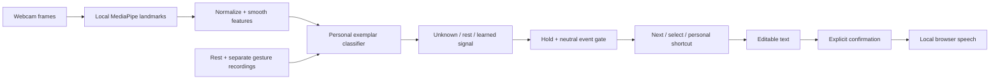

# Relay
**Your movement. Your words.**

Relay is a camera-based assistive communication prototype for the Triangle AI Hackathon 2026, Computer Vision track. It learns a person's resting behavior and chosen held movements, then turns recognized signals into controls for writing and speaking original text.

## New in 1.1
- **Signal studio:** live recognizer decisions, match distances, overlap diagnostics, and measured error breakdowns.
- **My vocabulary:** personal phrases and local word completion, reachable with the same gesture controls. Names and personal words take priority. Suggestions never insert automatically.
- **Draft recovery:** messages are saved locally per profile and restored after reload. Profile exports do not include drafts.
- **Focus view:** larger communication controls for a live demonstration, also reachable from the gesture keyboard.
- **Product plan:** see [PRODUCT.md](PRODUCT.md) for co-design, validation and commercialization hypotheses.

## Run
No API key, account, build step, or paid service is required.
```sh
cd relay
node scripts/serve.mjs
```
Open **http://localhost:4173** in current Chrome or Edge. The server binds only to this computer. Node 22+ is recommended. If Node is unavailable, run `python3 -m http.server 4173 --bind 127.0.0.1 --directory dist`.

All computer-vision assets are bundled in `dist/` (about 34 MB). Once downloaded, the local application does not need a network connection. Browser speech requires an installed local system voice. Opening index.html directly with file:// will not work: use the local server or HTTPS.

If models are absent, run `python3 scripts/download-assets.py`. Pinned download URLs and SHA-256 digests are in `dist/assets-manifest.json`.

## First successful session
1. Create a profile. Choose **Face & head** or **One hand**.
2. Enable the camera and allow browser camera access.
3. Record 12 seconds of natural rest. Keep the selected face/hand visible.
4. Add a distinct, comfortable held gesture. Assign **Select**. Follow five guided recordings.
5. Add a second gesture assigned **Next**. The profile switches to two-gesture navigation.
6. In **Check accuracy**, record new attempts for each gesture and run a rest check.
7. In **Write & speak**, choose **Use my gestures**, return to rest, then navigate.
8. **Next** advances rows; **Select** enters a row. Next advances keys; Select inserts one. Return to rest between signals. The final key in a selected row returns to row selection.
9. Speak opens a confirmation. Choose **Speak now** to speak; choose Cancel to return.
10. Export your profile under **My profiles**.

One-gesture access uses automatic scanning. Change scan rate, gesture hold duration, and neutral return duration in profile settings. Scanning freezes during a recognized hold and when tracking is lost. Pause exposes a Resume control accessible with the same Select signal.

## Implemented
- Face/head feature extraction (52 blendshapes + 4 normalized pose features + 4 experimental relative iris features).
- Single-hand extraction (63 wrist-centered, scale-normalized landmark coordinates).
- Natural resting calibration; five independent recordings per gesture.
- User-defined variable-size gesture vocabulary and editable action mappings.
- Personal feature selection, normalized nearest-exemplar classification, distance and ambiguity rejection.
- Sustained activation and neutral rearming; no repeated output from one held pose.
- Alphabet, capitalization, digits, symbols, spaces, punctuation, newline, delete, undo, clear confirmation, speech confirmation, pause/resume.
- One-signal automatic scanning or two-signal step navigation.
- Local profile persistence, import/export, selective retraining and disabling gestures.
- Independent attempt tests and rest checks; exported reports include timing, failures, and profile revision.
- Explicit pointer preview, separate from camera-controlled writing.
- Responsive interface and keyboard focus styles.

## Architecture

Pretrained vision locates body features. The personal recognizer learns from this user's recordings; it does not contain a fixed list of named gestures. Features are weighted by their separation across learned classes relative to within-class variability. A candidate must be close to its training exemplars and sufficiently separated from the next class. The similarity score is not a calibrated probability.

Training units are summaries of separate gesture bouts. Neutral samples cover consecutive windows of natural rest. Validation uses later, prompted attempts, never adjacent-frame random train/test splitting. Results are reset for the active revision when calibration, mappings, or timing change; older results remain in exports.

## Test
```sh
node --test tests/core.test.mjs tests/enhancements.test.mjs
node scripts/check.mjs
```
Optional browser checks (Chrome must be installed):
```sh
python3 scripts/setup-browser-tests.py
# In another terminal: node scripts/serve.mjs
node tests/browser.mjs
node tests/integration.mjs
node tests/enhanced-browser.mjs
node tests/vision.mjs
```
The first browser test uses a synthetic camera to check real MediaPipe initialization. The integration test substitutes synthetic feature vectors to exercise guided calibration, training, event gating, writing and profile restoration. These tests do **not** measure recognition accuracy on people. Do not present synthetic results as user performance.

## Privacy and storage
No backend, analytics, video upload, or raw-video recording. Word completion uses a small built-in local vocabulary plus explicitly supplied personal words; it is not an LLM. Features, labels, settings, personal vocabulary, drafts and validation records are saved in localStorage on the current origin. Exported JSON includes movement-derived features; treat it as personal data. Different browsers, computers, local URLs and hosted URLs have separate storage. Clearing site data erases local profiles. Export backups.

## Scope and limitations
This is a research prototype, not a validated medical device or a guarantee of communication access. We have not yet conducted user testing with people who use AAC. Calibration may be assisted. The communication phase can run with the learned signals.

Supported movements are observable facial/head poses or one-hand poses held briefly; arbitrary motion sequences, body movements outside the selected model, and all disabilities are not supported. Iris features are coarse and experimental; this is not calibrated screen gaze tracking. A hand profile needs the hand to remain visible even at rest.

Lighting, camera angle, glasses, fatigue, involuntary movements and camera changes can affect performance. Recheck after changing conditions. Unknown and lost tracking generate no selection. Repeatedly rejected movements may need retraining or replacement. Gesture count is limited by distinguishability, data size and user comfort; 26 gestures are not required.

The keyboard covers English letters and common digits/symbols; it is not a full multilingual OS input method. There is no global computer control, arbitrary app integration, or AI-authored sentence generation. The user chooses the message.

## Attribution and prior work
- [MediaPipe Face Landmarker](https://developers.google.com/edge/mediapipe/solutions/vision/face_landmarker?tab=Web) and [Hand Landmarker](https://developers.google.com/edge/mediapipe/solutions/vision/hand_landmarker?tab=Web): pretrained perception, runtime version 0.10.32.
- [MediaPipe source and license](https://github.com/google-ai-edge/mediapipe): runtime distributed under Apache-2.0.
- [ASHA AAC guidance](https://www.asha.org/practice-portal/professional-issues/augmentative-and-alternative-communication/): established scanning access methods.
- [GazeSpeak](https://www.microsoft.com/en-us/research/wp-content/uploads/2017/01/gazespeakUpdated.pdf) and [user-defined gesture research](https://link.springer.com/article/10.1007/s10209-024-01139-6): relevant prior art. We do not claim the broad concept is first-ever.
- Playwright 1.56.1 is an optional development test dependency, not shipped with the application.

Original application source is in `dist/src/`; presentation in `dist/index.html` and `dist/styles.css`. No build is needed to inspect or modify it.

Signal studio separation is a heuristic calculated from training samples and model radii. It is not held-out accuracy. Its four practice milestones are introductory checks, not clinical validation or the demo readiness targets. Evidence exports preserve this distinction.
