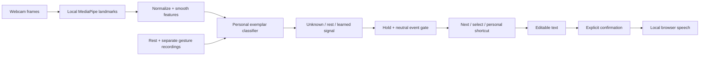

# Relay
**Your movement. Your words.**

Relay is a camera-based assistive communication prototype for the Triangle AI Hackathon 2026, Computer Vision track. It learns a person's resting behavior and chosen held poses and short movements, then turns recognized signals into controls for writing and speaking original text.

## New in 1.6 — Chord speed writing

Chord uses gesture shorthand to insert whole words or reusable text blocks. The speed hypothesis is **more text per deliberate action**, inspired by chorded input such as [Open Steno](https://www.openstenoproject.org/), not faster letter-by-letter finger tracing.

1. Open **Write & speak → Chord · speed writing → Start Chord input**. No calibration or paid API is needed.
2. Keep both whole hands visible on opposite sides of the mirrored preview. Close both fists to begin.
3. The hand on the preview's left chooses **bank 0–5**. Keep the other hand closed while browsing. Raise **1–5 fingers** on that other hand to choose a slot.
4. The selected text turns green after a short stable hold. **Close both fists to send it.** Intermediate finger counts while closing cannot change the armed choice. To cancel an armed choice, lower one hand for at least 0.3 seconds, then show both fists again.
5. Twenty editable shortcuts keep fixed codes; edit one to contain a frequently used phrase or code snippet. **Insert exactly** preserves whitespace for code. Word palette offers local next-word choices and five ambiguous prefix groups in bank 3; Spell and Symbols reach the full printable ASCII set.
6. **Race your keyboard** compares the same target with keyboard and camera input. The reusable-phrase scenario uses the starter codebook during the timed trial (0·1, 0·3, 1·3), even if personal shortcuts have been edited. The word scenario requires word selection/spelling. Practice first. Export the comparison to preserve session results.

Each trial starts explicitly, ends only on an exact target match (trailing whitespace allowed), and includes correction time. WPM is target characters / 5 / elapsed minutes. Keyboard paste/drop and pointer text entry during camera trials are blocked. Separate trial drafts protect the regular message. Results are the most recent trial per method/scenario, not population averages. Exported results are a local practice log, not tamper-proof evidence.

**We have not established that Chord beats a physical keyboard on novel prose.** Reusable phrase throughput measures text expansion, which also has keyboard-based alternatives. Learning time, camera latency, correction rate, fatigue and live recognition require user testing. No language model writes or guesses sentences for the user.

Chord runs one local two-hand MediaPipe worker on CPU; no face model is loaded. Its release gate requires fresh frames and cancels on loss or staleness. Timing is configurable at 120/180/260 ms. Existing environments retain their camera settings. Shortcuts persist per profile (and in profile backups), or in a separate guest store. No video or landmark stream is saved.

Validation: node tests/chord.test.mjs covers all 30 codes, cancellation, stale frames, text/undo, full ASCII, profile validation and timing math. node tests/chord-browser.mjs exercises controlled hand landmarks through phrases, word composition, editable literal snippets, benchmark isolation, mobile layout and persistence. node tests/chord-camera.mjs checks worker setup, startup/runtime fallback and real bundled MediaPipe initialization. These automated inputs are not live-user speed or accuracy measurements.

## New in 1.5: Cirrin ring
A fourth communication environment follows the word-level circular keyboard interaction introduced by Jennifer Mankoff and Gregory Abowd in 1998: https://sites.cc.gatech.edu/fce/pendragon/publications/cirrin98.pdf

Relay uses an alphabetical A–Z ring, a webcam pinch as pen-down, visible word paths, and explicit review. Pinch in the center, visit each letter tile, travel through the center to skip unwanted letters, and release to review. Return inward before revisiting a letter to spell doubles. Hold thumbs-up to insert the exact spelling with a trailing space, or choose a displayed word button. One Undo removes the inserted word. Mouse/touch dragging and letter buttons also work.

The HELLO guide labels a practice route. Movement range and Center on my finger adapt the dial to the drawing hand. Letter boundaries use a dead zone and fresh-frame stability; tracking loss interrupts a draft and never inserts text. Optional nearby-word suggestions use a small local vocabulary plus personal words. Literal spelling always remains available, including words absent from the vocabulary. Cirrin's decoder uses spatial letter visits, not the Air letters handwriting model. No new model download or API is required.

Run node tests/cirrin-browser.mjs for controlled fingertip/pointer word input, doubled letters, confirmation, spacing, undo, speech, responsive camera docking, and persistence. Core tests are included in npm test. These checks do not measure real-user speed or accuracy.

## New in 1.4
- **Air letters environment:** index-tip trajectories become multi-stroke ink. Pinch thumb/index to draw, release to reposition, pause for three handwriting-model suggestions, and hold thumbs-up for 850 ms to insert the first choice (or click any choice). Mouse/touch drawing and correction buttons are available. No letter is automatically inserted.
- **Local neural inference:** an MIT-licensed EMNIST Balanced CNN runs in a dedicated ONNX Runtime Web worker. Upright, aspect-preserving, centered 28×28 rasters at three stroke widths are averaged. Lower/uppercase classes are combined; digit lookalikes remain visibly ambiguous. No API key, video upload, or training is needed for this environment.
- **More tolerant finger counts:** image-plane and 3D evidence combine tip reach, overall extension, bends and thumb separation. A single bent/noisy joint no longer vetoes a whole hand. Fresh-frame stability and short uncertainty pauses reduce flicker without allowing uncertain frames to select a cell.
- **Shared workspace:** Classic, Finger grid and Air letters share message text, undo, speech confirmation and saved drafts. Switching environments stops active input.
- **Limits:** air writing is one printed A–Z letter at a time, not cursive word recognition. Constructed trace/geometry checks are not evidence of accuracy on people; real-camera testing remains necessary.

### Try Air letters
Write & speak → Environment: Air letters → Start air writing. Keep one full hand in view. Touch thumb and index fingertips and move the index tip to draw. Separate them to lift the pen; pinch again for another stroke. After a roughly one-second pause, review the choices. Hold a thumbs-up to insert the first, or click the desired letter. Space, punctuation, Delete, Undo and case are below the pad. The camera stays visible while scrolling.

### Additional checks
Run node tests/letter-model.mjs for the actual bundled neural model on 26 constructed paths at two jitter levels (52 checks; not human accuracy). Run node tests/air-browser.mjs for tracked pinch paths through actual inference, deliberate insertion, editing, confirmation, environment switching and desktop/mobile camera visibility. Run node tests/finger-vision.mjs for actual MediaPipe inference on public hand photos, and node tests/finger-environment.mjs for coordinate typing. Model provenance and exact licenses are in dist/MODEL_NOTICES.md.

## New in 1.2
- **All signals by default:** one profile tracks facial expressions, head poses, and both hands together. There is no face-versus-hand choice during setup.
- **Held poses and movements:** teach a held pose or record a short finger swipe/movement. Five motion sequences retain order and direction; temporal matching tolerates modest speed differences. This is experimental gesture-command recognition, not continuous swipe-to-word typing.
- **Learned contributing parts:** each gesture learns which channels matter from its own examples and relaxed lead-ins. Missing hands do not block face-only commands; two-hand classes require both tracked hands.
- **Shared intent protection:** each gesture needs its own neutral preparation; a command locks until its contributing parts return to rest. Scanning freezes during a motion and return strokes do not repeat commands.
- **Visible tracking:** face, left-hand and right-hand indicators, plus both hand skeletons.
- **Compatibility:** existing face/hand profiles, vocabulary, drafts and backups remain supported. Create a new all-signals profile to add these new capabilities.
- **Cleaner form:** the Insert text box appears only for that action.

## New in 1.1
- **Signal studio:** live recognizer decisions, match distances, overlap diagnostics, and measured error breakdowns.
- **My vocabulary:** personal phrases and local word completion, reachable with the same gesture controls. Names and personal words take priority. Suggestions never insert automatically.
- **Draft recovery:** messages are saved locally per profile and restored after reload. Profile exports do not include drafts.
- **Focus view:** larger communication controls for a live demonstration, also reachable from the gesture keyboard.
- **Product plan:** see [PRODUCT.md](PRODUCT.md) for co-design, validation and commercialization hypotheses.

## Run
No API key, account, build step, or paid service is required.
```sh
cd relay
node scripts/serve.mjs
```
Open **http://localhost:4173** in current Chrome or Edge. The server binds only to this computer. Node 22+ is recommended. If Node is unavailable, run `python3 -m http.server 4173 --bind 127.0.0.1 --directory dist`.

All computer-vision assets are bundled in `dist/` (including the local handwriting runtime). Once downloaded, the local application does not need a network connection. Browser speech requires an installed local system voice. Opening index.html directly with file:// will not work: use the local server or HTTPS.

If models are absent, run `python3 scripts/download-assets.py`. Pinned download URLs and SHA-256 digests are in `dist/assets-manifest.json`.

## First successful session
1. Create a profile. Face and both hands are available together automatically.
2. Enable the camera and allow browser camera access.
3. Record 12 seconds of natural rest. Keep your face visible, plus any hands you plan to use.
4. Add a distinct, comfortable gesture and assign **Select**. Choose **Hold a pose** or **Make a swipe or movement**. Follow five guided recordings, keeping the parts you use visible during each neutral lead-in.
5. Add a second gesture assigned **Next**, using the same or different body parts. The profile switches to two-gesture navigation.
6. In **Check accuracy**, record new attempts for each gesture and run a rest check.
7. In **Write & speak**, choose **Use my gestures**, return to rest, then navigate.
8. **Next** advances rows; **Select** enters a row. Next advances keys; Select inserts one. For movements, pause at the endpoint, then return to the learned starting pose. Return to rest between signals. The final key in a selected row returns to row selection.
9. Speak opens a confirmation. Choose **Speak now** to speak; choose Cancel to return.
10. Export your profile under **My profiles**.

One-gesture access uses automatic scanning. Change scan rate, gesture hold duration, and neutral return duration in profile settings. Scanning freezes during a recognized hold and when tracking is lost. Pause exposes a Resume control accessible with the same Select signal.

## Implemented
- Face/head feature extraction (52 blendshapes + 4 normalized pose features + 4 experimental relative iris features).
- Both-hand extraction (63 wrist-centered shape features plus wrist/index-tip image coordinates per hand); presence masks explicitly gate availability.
- Combined 201-value schema, per-gesture channel inference, and order-preserving temporal template matching for motion gestures.
- Legacy face (60) and hand (63) feature schemas retained.
- Natural resting calibration; five independent recordings per gesture.
- User-defined variable-size gesture vocabulary and editable action mappings.
- Personal feature selection, normalized nearest-exemplar classification, distance and ambiguity rejection.
- Sustained activation and neutral rearming; no repeated output from one held pose.
- Alphabet, capitalization, digits, symbols, spaces, punctuation, newline, delete, undo, clear confirmation, speech confirmation, pause/resume.
- One-signal automatic scanning or two-signal step navigation.
- Local profile persistence, import/export, selective retraining and disabling gestures.
- Independent attempt tests and rest checks; exported reports include timing, failures, and profile revision.
- Explicit pointer preview, separate from camera-controlled writing.
- Responsive interface and keyboard focus styles.

## Architecture

Pretrained vision locates body features. The personal recognizer learns from this user's recordings; it does not contain a fixed list of named gestures. Features are weighted by their separation across learned classes relative to within-class variability. A candidate must be close to its training exemplars and sufficiently separated from the next class. The similarity score is not a calibrated probability.

Training units are summaries of separate gesture bouts. Neutral samples cover consecutive windows of natural rest. Validation uses later, prompted attempts, never adjacent-frame random train/test splitting. Results are reset for the active revision when calibration, mappings, or timing change; older results remain in exports.

## Test
```sh
npm test
node scripts/check.mjs
```
Optional browser checks (Chrome must be installed):
```sh
python3 scripts/setup-browser-tests.py
# In another terminal: node scripts/serve.mjs
node tests/browser.mjs
node tests/integration.mjs
node tests/enhanced-browser.mjs
node tests/combined-browser.mjs
node tests/vision.mjs
```
The first browser test uses a synthetic camera to check real MediaPipe initialization. The integration test substitutes synthetic feature vectors to exercise guided calibration, training, event gating, writing and profile restoration. These tests do **not** measure recognition accuracy on people. Do not present synthetic results as user performance.

## Privacy and storage
No backend, analytics, video upload, or raw-video recording. Word completion uses a small built-in local vocabulary plus explicitly supplied personal words; it is not an LLM. Features, labels, settings, personal vocabulary, drafts and validation records are saved in localStorage on the current origin. Exported JSON includes movement-derived features; treat it as personal data. Different browsers, computers, local URLs and hosted URLs have separate storage. Clearing site data erases local profiles. Export backups.

## Scope and limitations
This is a research prototype, not a validated medical device or a guarantee of communication access. We have not yet conducted user testing with people who use AAC. Calibration may be assisted. The communication phase can run with the learned signals.

New profiles support observable facial/head poses, one- or two-hand poses, and recorded short movements. Complex sign-language interpretation, continuous swipe typing, arbitrary whole-body gestures, and universal disability access are not supported. Iris features are coarse and experimental; this is not calibrated screen gaze tracking. Any hand used by a gesture needs to remain visible during its neutral lead-in and gesture. Crossed/occluded hands and changing camera position can interrupt recognition.

Lighting, camera angle, glasses, fatigue, involuntary movements and camera changes can affect performance. Recheck after changing conditions. Unknown and lost tracking generate no selection. Repeatedly rejected movements may need retraining or replacement. Gesture count is limited by distinguishability, data size and user comfort; 26 gestures are not required.

The keyboard covers English letters and common digits/symbols; it is not a full multilingual OS input method. There is no global computer control, arbitrary app integration, or AI-authored sentence generation. The user chooses the message.

## Attribution and prior work
- [MediaPipe Face Landmarker](https://developers.google.com/edge/mediapipe/solutions/vision/face_landmarker?tab=Web) and [Hand Landmarker](https://developers.google.com/edge/mediapipe/solutions/vision/hand_landmarker?tab=Web): pretrained perception, runtime version 0.10.32.
- [MediaPipe source and license](https://github.com/google-ai-edge/mediapipe): runtime distributed under Apache-2.0.
- [ASHA AAC guidance](https://www.asha.org/practice-portal/professional-issues/augmentative-and-alternative-communication/): established scanning access methods.
- [GazeSpeak](https://www.microsoft.com/en-us/research/wp-content/uploads/2017/01/gazespeakUpdated.pdf) and [user-defined gesture research](https://link.springer.com/article/10.1007/s10209-024-01139-6): relevant prior art. We do not claim the broad concept is first-ever.
- Playwright 1.56.1 is an optional development test dependency, not shipped with the application.

Original application source is in `dist/src/`; presentation in `dist/index.html` and `dist/styles.css`. No build is needed to inspect or modify it.

For held poses, Signal studio separation is a heuristic calculated from training samples and model radii. Movement cards report temporal matching instead of a pose-separation score. It is not held-out accuracy. Its four practice milestones are introductory checks, not clinical validation or the demo readiness targets. Evidence exports preserve this distinction.

## Combined recognition details
Presence flags are never classifier features. Each gesture automatically selects contributing channels from its five examples versus neutral recordings. Held poses use a per-gesture rest/pose exemplar model; conflicting simultaneous matches abstain. Motion samples retain 24 frames and use selected changing dimensions, time resampling and banded dynamic time warping. Candidate movement windows must preserve tracking, start near the taught neutral, have enough displacement, end briefly still, and be separated from competing motion templates. Runtime rearming and readiness are tracked per gesture. No training runs on a server.

The new motion and two-hand paths have software and static-image checks, but have not yet been measured on the user's live webcam. Use Check accuracy and rest checks for each new gesture. The user's earlier successful face-only session is not evidence of accuracy for this upgrade.

## Fingertip trails (1.2.3)
Turn on **Enable trails** below the camera to draw neon paths with your index fingers. Left and right hand tracks use cyan and pink, and each path fades over 1.4 seconds. It works before gesture calibration in combined and hand profiles. Trails are only a visual aid; they do not change recognition or interpret drawn letters. The browser remembers the toggle, but paths are not saved. Brief, plausible tracking gaps up to 320 ms reconnect; longer losses or large jumps start a separate stroke. Speed-adaptive filtering and bounded cubic curves reduce jitter and rigid corners. Turning trails off or stopping the camera clears it.
Fast-motion tracking requests up to 60 camera frames per second where the webcam supports it. Separate local workers process hands and face, with one in-flight image per model and no frame backlog. Face processing is capped during combined tracking to leave capacity for hands; unsupported or failed workers fall back automatically. Hand tracking tolerates more inter-frame box motion while preserving detection/presence thresholds. The camera card reports measured camera and hand/face processing rates; these are not recognition-accuracy scores. Blur, occlusion, lighting and hardware still limit real performance. No reconstructed trail point feeds the recognizer.

Additional camera checks: `node tests/trails-browser.mjs`, `node tests/camera-pipeline.mjs`, `node tests/worker-probe.mjs`, and `node tests/camera-failure.mjs`. Worker-probe uses the public fixtures prepared for `tests/vision.mjs`. `node tests/performance.mjs after` records a local synthetic-camera measurement; it is not a live user benchmark.


## Writing with a learned movement (1.2.4)
In an all-signals profile, learn rest, then choose **Teach a writing movement**. Movement and Insert text are selected for you. Enter a name and the exact letter, word or phrase to write; record five examples of the stroke, pausing at its endpoint each time. In **Write & speak**, enable the camera and choose **Use my gestures**. Perform the learned movement, pause, and return to its starting pose before repeating. Direct text gestures work without Next or Select; those controls remain available for keyboard navigation. Recognition uses your taught vocabulary and does not automatically transcribe untrained handwriting.

During teaching, the camera is larger and stays beside the current instruction and progress. On narrow screens it docks at the top. The camera panel includes Cancel recording, so you can stop without finding the original instructions below. The existing rest and validation workflows use the same persistent preview.

`node tests/movement-writing.mjs` verifies direct motion-to-text writing without navigation gestures, no repeated insertion at a held endpoint, a stationary scan highlight, shortcut defaults, scrolling visibility at four screen sizes, cancellation, camera-stop cleanup and saved drafts. Its camera stream is a controlled test fixture, not a human accuracy measurement.


## Communication environments (1.3)
The selector in **Write & speak** chooses a communication method. **Classic keyboard** remains the default and keeps learned poses, movements, Next/Select and direct text. **Finger grid** is a separate 6×6 coordinate keyboard. Both share the message, undo history, phrases, speech confirmation and saved draft. Environment changes stop live input; start it explicitly in the new environment. Profile backups retain environment, hold-time and hand-role preferences. Guest Finger grid also works without training or creating a profile.

### Finger grid
1. Choose **Finger grid**, then **Start finger input** and allow the camera.
2. Face both palms toward the camera, separated on the left and right sides of the mirrored preview. A fist is 0; the number of extended fingers, including the thumb, is 1–5. The thumb counts when extended away from the palm.
3. By default, the hand on the preview's left supplies the row; the other supplies the column. For example, row 1 / column 1 writes **h**, and 1 / 2 writes **i** on Letters. Preview readouts highlight the target before selection.
4. Hold a stable pair to select once. Change the pair for the next cell. To repeat the same cell, lower either hand briefly (at least 0.3 seconds), then show the pair again. Brief tracking glitches and ambiguous folds do not rearm a held key. Hold duration defaults to 0.85 seconds; settling after a previous selection can add a short delay. Timing & hand roles lets you adjust it or swap hands.
5. The bottom row stays consistent: **Delete, Undo, Case, Speak, Tools, Page →**. Row 5 / column 5 cycles **Letters → Numbers → Symbols → My phrases**. This reserves 30 content cells per page and removes the 36-symbol limit. Tools contains new line, clear, pause, page shortcuts and phrase saving. Speak and Clear open a separate confirmation grid; Cancel is 0/0, Confirm is 0/1. Resume is 0/0 when paused.

Finger counting uses the existing local hand landmarks and conservative finger-joint geometry, not personalized learned gestures or language-model interpretation. Hand roles are assigned by preview position, independent of the detector's handedness labels. Missing, overlapping, edge-on, cropped or uncertain hands produce no selection. Keep the whole hands visible. No raw hand images or landmark streams are saved. The communication environment registry, page definitions and finger controller live in separate modules; future layouts such as a dial can share the same composer.

The Finger grid hand worker uses CPU inference: on this development machine, the GPU path missed one hand in an official two-hand static fixture while the CPU path detected both at the same thresholds. Classic retains GPU tracking. Both use workers where supported, with existing compatibility fallback; actual laptop performance still needs checking.

Additional tests: `node tests/environments.test.mjs`, `node tests/finger-environment.mjs`, `node tests/finger-vision.mjs`, and `node tests/worker-probe.mjs CPU`. The vision test uses ignored public [MediaPipe test fixtures](https://github.com/google-ai-edge/mediapipe/blob/master/mediapipe/tasks/testdata/vision/BUILD): two-hands.jpg (existing right_hands.jpg fixture), fist.jpg, pointing_up.jpg, victory.jpg, thumb_up.jpg from storage.googleapis.com/mediapipe-assets. These are engineering checks, not measured live-user accuracy.
