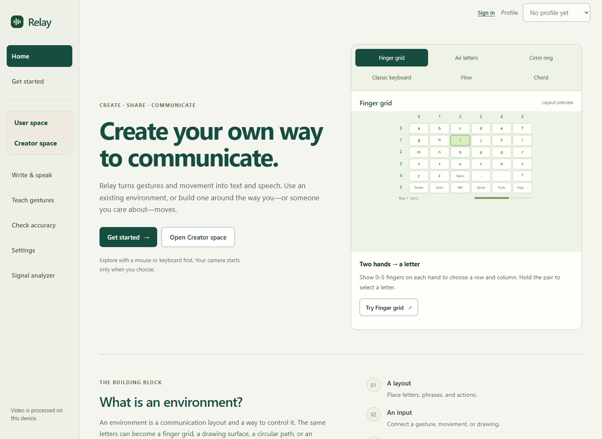
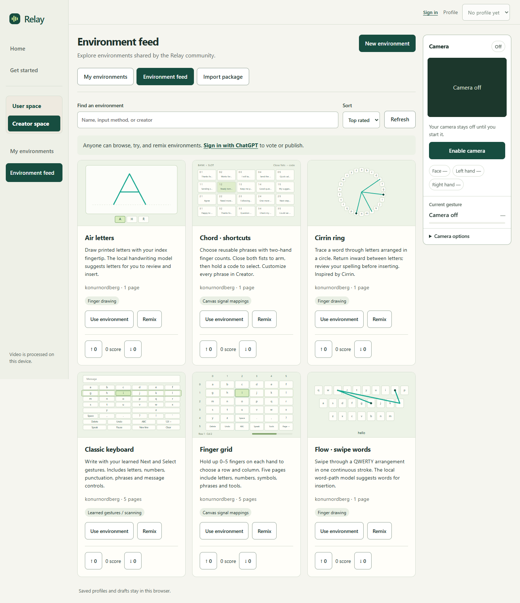
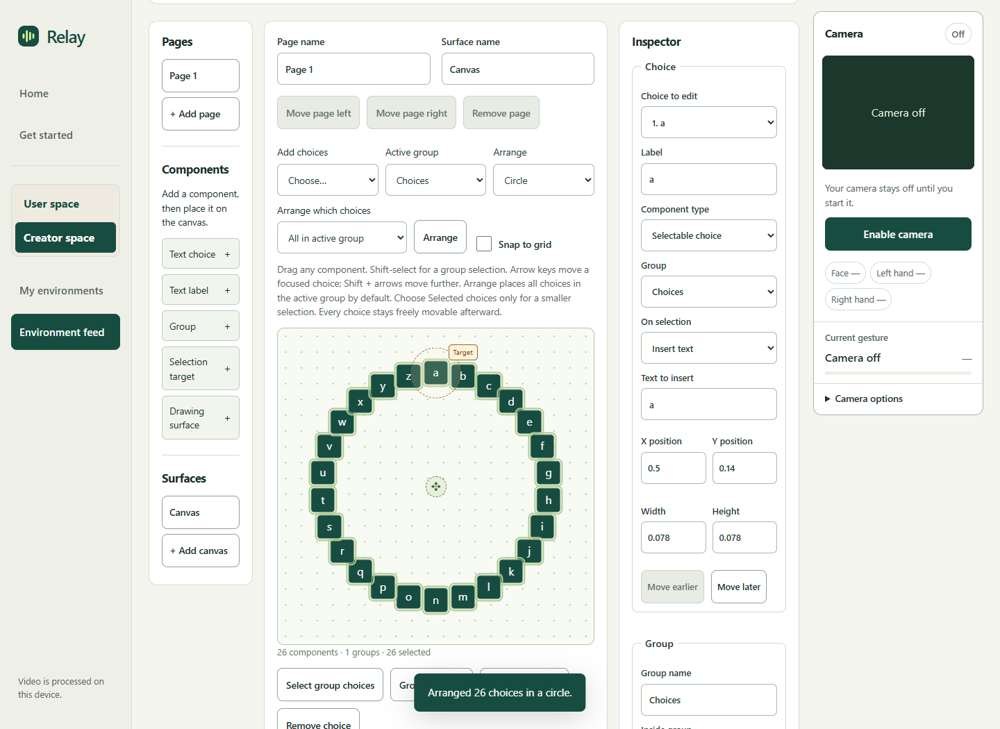
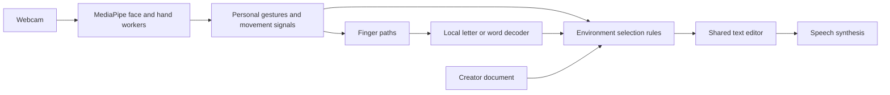

<div align="center">
  
  <h1>Relay</h1>
  <p><strong>Build a way to communicate around the movements you can make.</strong></p>
  <p>Personal gestures. Visual creation. Shared communication environments.</p>
  <p><a href="https://relay-personal-voice.parlaygoat.chatgpt.site/">Try Relay</a> · <a href="CREATOR.md">Build an environment</a> · <a href="docs/ARCHITECTURE.md">Explore the architecture</a></p>
</div>



I built Relay around a simple question: **what if the interface adapted to the person using it?**

A raised eyebrow, an open hand, or a small movement can become a way to write. Relay learns personal signals through a webcam, turns them into text and speech, and lets someone build a different interface when the existing ones do not fit. A family member or creator can arrange characters, connect movements to controls, and share that environment for others to try and remix.

Built by **[Konur Nordberg](https://github.com/konurnordberg)** for the **Triangle AI Hackathon 2026 · Computer Vision track**.

## Three spaces, one communication platform

- **User space:** calibrate comfortable gestures, choose an environment, and write, edit, undo, or speak a message. The same message travels with you between environments.
- **Creator space:** place characters and phrases on a canvas, group them, connect measured inputs to properties, and define how a selection happens. Test the result, then use it immediately.
- **Environment feed:** browse, try, remix, publish, and vote on shared environments. Browsing and local use need no account; publishing and voting use ChatGPT sign-in on the hosted app.

## Six ways to start

| Environment | How it works |
| --- | --- |
| **Classic** | Teach Next and Select gestures to navigate a full keyboard. One reliable selection gesture can also work with automatic scanning. |
| **Finger grid** | Show 0–5 fingers on each hand to choose a row and column. Hold to select; switch pages for more than 36 characters and actions. |
| **Air letters** | Draw with your index finger, lift with an open hand, and review suggestions from a local handwriting model. |
| **Cirrin** | Trace through letters around a ring to spell a word in a continuous movement. |
| **Flow** | Trace a word over QWERTY. A local decoder ranks candidates from a 20,000-word vocabulary. |
| **Chord** | Select gesture shortcuts for phrases and code snippets, with spelling controls for other text. |



## The creator is the interesting part

A hand-controlled dial does not need a dial-specific builder. It can be made from:

**26 choices → a group → a circle arrangement → hand rotation mapped to group rotation → a fixed target → a dwell rule.**

Change the arrangement to a line and map hand position to horizontal movement: now it is a sliding character strip. Keep the layout and change the selection rule: now it can scan or use finger counts. Layout, control, and selection are separate parts.



[Build Palm Writer from a blank canvas →](CREATOR.md)

Creator supports free placement, nested groups, input ranges, conditions, multiple pages, drawing surfaces, and portable JSON packages. It combines a defined set of signals and local models; adding a new kind of sensor or model still requires code. The original six environments also have editable templates for remixing.

## Run locally

Use **Node.js 24** and a current desktop Chrome or Edge browser.

```bash
git clone https://github.com/konurnordberg/relay.git
cd relay
npm ci
npm start
```

Open **[localhost:4173](http://localhost:4173)**. No API key, GPU, or paid service is needed. Vision models and runtimes are included in the repository, so the clone is larger than a typical static site.

For a first session:

1. Open **Get started**, create a profile, and allow the camera when requested.
2. Record your resting state, then teach two distinct, comfortable gestures for **Next** and **Select**.
3. Check the gestures on fresh attempts. In **User space**, choose **Classic** and start camera input.
4. Write a short word, try Delete and Undo, and speak it. You can also edit the message with your physical keyboard.
5. Open **Creator space** or the **Environment feed** to explore other layouts. Finger grid and hand-controlled canvas inputs do not require a personal gesture vocabulary.

Local preview uses a simulated account and a local SQLite feed. It does not authenticate through ChatGPT. See [development setup](docs/DEVELOPMENT.md) for guest preview, browser checks, and hosting details.

## What runs under the hood



- **Personal recognition over pretrained vision.** MediaPipe locates landmarks; Relay learns examples of a person's rest, poses, and short movements. It does not retrain the vision model or ask an LLM to guess what someone wants to say.
- **Intent before activation.** Confidence checks, tracking freshness, hold times, and release requirements separate a detected movement from a committed action. The signal analyzer exposes competing matches.
- **Responsive local inference.** Face, hand, handwriting, and word decoding use workers. Vision processes the latest frame instead of building a queue. Visual trail repair stays separate from recognition.
- **Environments as data.** Validated documents describe components, mappings, and rules. The same documents power preview, installation, export, and the shared feed.

Read the [architecture walkthrough](docs/ARCHITECTURE.md) for the data flow and the most useful source entry points.

## Privacy and sharing

Camera frames are processed in the browser. Relay does not upload camera video. Personal calibration, profiles, and message drafts stay on the device unless you explicitly export them.

Publishing an environment shares its layout, output text, and any custom sketch examples with the public feed. It does **not** include personal face/hand calibration. Published environments and votes live in the server database. Speech uses the browser's available voices; voice availability and offline behavior depend on the device and browser.

## Check the project

```bash
npm test       # Recognition, editing, environments, creator, and feed logic
npm run check  # JavaScript syntax and bundled model/runtime checksums
npm run build  # Static client and feed worker bundles
```

Browser regression scripts additionally cover camera lifecycle, saved-profile compatibility, Creator editing, responsive layouts, and feed flows. See [testing instructions](docs/DEVELOPMENT.md#validation).

## Where to look in the code

| Area | Start here |
| --- | --- |
| Camera and worker scheduling | [camera.js](dist/src/camera.js), [vision-lane.js](dist/src/vision-lane.js), [vision-worker.js](dist/src/vision-worker.js) |
| Personal gesture recognition | [features.js](dist/src/features.js), [core.js](dist/src/core.js), [combined.js](dist/src/combined.js) |
| Finger counting and pen tracking | [finger-index.js](dist/src/finger-index.js), [vision-pen.js](dist/src/vision-pen.js) |
| Handwriting and word paths | [letter-recognizer.js](dist/src/letter-recognizer.js), [flow-core.js](dist/src/flow-core.js) |
| Visual environment language | [creator-schema.js](dist/src/creator-schema.js), [creator-scene.js](dist/src/creator-scene.js), [creator-scene-input.js](dist/src/creator-scene-input.js) |
| Canvas editor and runtime | [creator-canvas-editor.js](dist/src/creator-canvas-editor.js), [creator-runtime.js](dist/src/creator-runtime.js) |
| Shared feed and ownership | [worker/index.js](worker/index.js), [db/schema.ts](db/schema.ts) |

**`dist/` contains the browser source.** Only `dist/client/`, `dist/server/`, and `dist/.openai/` are generated build output. The name is historical; the source has been kept in place to preserve the working app.

## Current stage

Relay is a working hackathon prototype. In an early real-camera session, I wrote **“hi” with an eyebrow raise for Next and an open-mouth gesture for Select**, then tested deletion, undo, and speech. That is a useful first demonstration, not evidence of reliability across people.

The next step is co-design and repeated-session evaluation with people who use alternative communication. Recognition still depends on visibility, lighting, movement, and camera quality. There is no claim of universal accessibility, clinical validation, or typing faster than a physical keyboard. Relay currently writes inside the app, rather than acting as a system-wide keyboard.

## More

[Project story](ABOUT.md) · [Creator guide](CREATOR.md) · [Demo walkthrough](DEMO.md) · [Product direction](PRODUCT.md) · [Changelog](CHANGELOG.md) · [Contributing](CONTRIBUTING.md)

Relay builds on MediaPipe, ONNX Runtime Web, an EMNIST handwriting model, the FrequencyWords vocabulary, and prior work including Cirrin. See [third-party credits and licenses](THIRD_PARTY_NOTICES.md). This repository does not currently grant an open-source license for Relay's original application code; third-party assets retain their own licenses.
