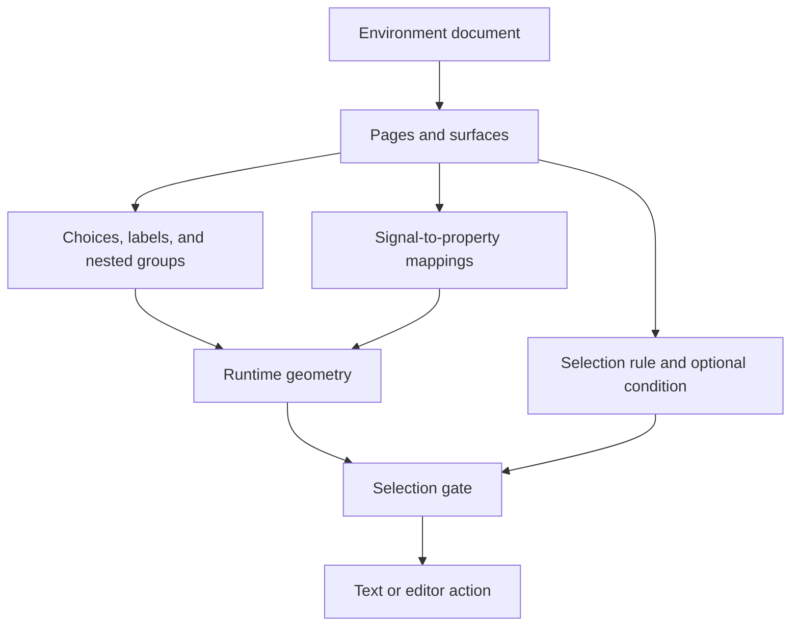

# How Relay works

Relay separates three questions: **what moved, what does that movement mean for this person, and what should the current interface do with it?**

The browser handles perception, personal recognition, text composition, and rendering. The server handles shared environments, ownership, and votes. There is no hosted model call in the camera-to-text path.

## 1. From camera frames to signals

[`camera.js`](../dist/src/camera.js) owns camera startup, shutdown, landmarks, and fallback behavior. [`vision-lane.js`](../dist/src/vision-lane.js) schedules independent face and hand workers with one in-flight frame per lane. When inference is slower than capture, it takes the newest available frame instead of processing an old queue.

[`vision-worker.js`](../dist/src/vision-worker.js) runs the bundled MediaPipe tasks. Face features and hand landmarks become normalized measurements rather than raw images in personal training records. Face and hand availability are tracked separately so a missing hand is not mistaken for a valid zero-valued measurement.

[`trails.js`](../dist/src/trails.js) smooths the visible fingertip trail and bridges plausible short gaps. Its repaired points do not feed gesture recognition. A pleasing line is not proof that the camera observed the missing motion.

## 2. From signals to intentional actions

[`core.js`](../dist/src/core.js), [`features.js`](../dist/src/features.js), and [`combined.js`](../dist/src/combined.js) implement the personal vocabulary. Teaching captures rest and repeated examples of a chosen signal. Held poses are compared against learned examples; short movements use resampled sequences and dynamic time warping.

Classification and activation are separate. The recognizer can report a known gesture while the activation gate is waiting for a deliberate hold, rest, or release. Unknown input, stale tracking, and missing required channels must not write text. [`profile-runtime.js`](../dist/src/profile-runtime.js) preserves compatibility with older saved profiles; [`insights.js`](../dist/src/insights.js) exposes the recognition evidence.

[`finger-index.js`](../dist/src/finger-index.js) derives stable finger counts from hand geometry for the two-hand grid. [`vision-pen.js`](../dist/src/vision-pen.js) provides shared point/open-hand and optional pinch pen controls.

## 3. Letter and word paths

- **Air letters:** normalize captured strokes into image tensors, run the bundled EMNIST classifier through ONNX Runtime Web in a worker, combine predictions from three stroke widths, and offer candidates for review. See [`letter-raster.js`](../dist/src/letter-raster.js), [`letter-recognizer.js`](../dist/src/letter-recognizer.js), and [`letter-worker.js`](../dist/src/letter-worker.js).
- **Cirrin:** record visits to letter regions around a ring; review the captured sequence before insertion. See [`cirrin-core.js`](../dist/src/cirrin-core.js).
- **Flow:** compare a resampled path against word templates using geometry, endpoint information, frequency, and dynamic time warping. The 20,000-word vocabulary is data, not an LLM. See [`flow-core.js`](../dist/src/flow-core.js) and [`flow-worker.js`](../dist/src/flow-worker.js).

## 4. A communication interface as a document

A Creator environment is a validated JSON document. Pages contain canvases or drawing surfaces. A canvas contains choices, labels, groups, input mappings, and a selection rule.

The separation is deliberate: arranging choices in a circle does not decide how they are selected. A rotation mapping can move them under a fixed target; a scan rule can visit them one by one; a path rule can concatenate visited choices.

- [`creator-schema.js`](../dist/src/creator-schema.js): document validation, version compatibility, bounds, and supported types.
- [`creator-scene.js`](../dist/src/creator-scene.js): group transforms, arrangements, and scene geometry.
- [`creator-scene-input.js`](../dist/src/creator-scene-input.js): input mappings, conditions, target selection, and dwell.
- [`creator-canvas-editor.js`](../dist/src/creator-canvas-editor.js): direct editing, selection, dragging, and numeric controls.
- [`creator-runtime.js`](../dist/src/creator-runtime.js): run an environment in preview or User space.
- [`creator-store.js`](../dist/src/creator-store.js): draft and installed-snapshot persistence.

A saved draft, an installed copy, and a published package have separate lifecycles. Editing a draft does not silently change an installed environment or a public listing. Packages contain configuration, not executable JavaScript or arbitrary model uploads.

## 5. Shared composition

[`communication.js`](../dist/src/communication.js), [`drafts.js`](../dist/src/drafts.js), and [`app.js`](../dist/src/app.js) connect environment actions to text, undo, completion, phrases, and speech. Moving between environments preserves the message. Physical-keyboard editing remains available.

## 6. The public feed

[`worker/index.js`](../worker/index.js) implements the feed API with Web Standard Request/Response objects. [`db/schema.ts`](../db/schema.ts) and [`drizzle/`](../drizzle/) define the database and migrations. [`worker/catalog.js`](../worker/catalog.js) installs the six built-in examples idempotently.

Anonymous visitors can browse public packages. The hosting gateway supplies authenticated identity for publishing and voting. Ownership checks control updates and deletion; one reversible vote is stored per environment/account. Private legacy documents remain visible only to their owner until explicitly republished.

The worker validates packages and enforces request bounds. Public packages include their output text and custom sketch examples; camera frames, personal gesture calibration, and private message drafts are outside this API.

**Hosting boundary:** the production worker trusts identity headers supplied by its hosting gateway. A standalone deployment must strip untrusted copies and supply verified identity itself. The local SQLite preview simulates accounts for development and is not a production authentication server.

## Tools and dependencies

The client uses JavaScript modules, HTML, CSS, Canvas, Web Workers, MediaPipe Tasks Vision, ONNX Runtime Web, and browser speech synthesis. The server uses a D1 binding in production and a SQLite adapter in local preview. Esbuild bundles the worker; Drizzle describes the schema and migrations.

See [development setup](DEVELOPMENT.md), [model provenance](../dist/MODEL_NOTICES.md), and [third-party notices](../THIRD_PARTY_NOTICES.md).
